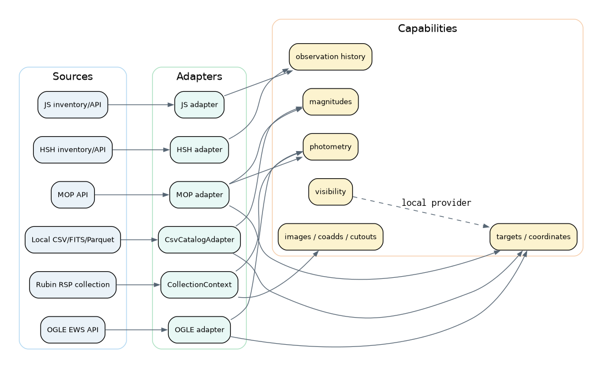
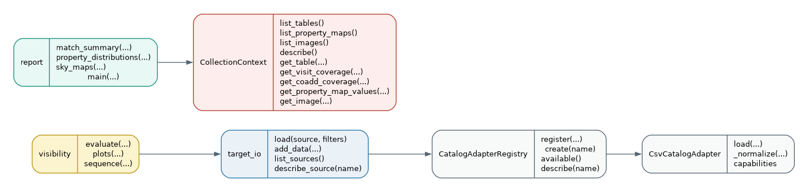

# Current architecture

The package is organized around reusable data sources, explicit tasks and the seasonal planning workflow. There is no single generic orchestration layer that wraps every analysis.

## Main flow

```text
TOM providers + local follow-up inventories + Rubin/reference data
                              |
                    target_selection.sources
                              |
     target_selection.tasks and target_selection.planning
                              |
                 target_selection.prioritization
                              |
             tables, plots, reports and seasonal PDF
```

## Package areas

| Area | Responsibility |
|---|---|
| `target_selection.sources` | Provider and survey adapters, including MOP, OGLE/OPM, BHTOM, HSH/JS and Rubin access. |
| `target_selection.tasks` | Explicit units of work for targets, visibility, Rubin data, surveys and reports. |
| `target_selection.planning` | Candidate loading, photometry assembly, visibility products and seasonal report products. |
| `target_selection.prioritization` | Evidence-based scientific category and within-category rank. |
| `target_selection.reference_catalog` | Large coordinate-catalog enrichment and Rubin coadd products. |
| `target_selection.cache_paths` | Canonical shared paths for reusable provider and query caches. |
| `target_selection.target_registry` | Optional normalized SQLite record of targets, source records, photometry and runs. |

## Entry points

- `target-selection-plan` runs the seasonal planning workflow.
- `target-selection catalog` runs reference-catalog enrichment.
- `target-selection visibility` runs the interactive visibility tool.
- `target_selection.tasks` exposes independent operations for notebooks and scripts.

The CLI implementations live in `planning_cli.py`, `cli.py`, and `visibility_cli.py` respectively. Each uses the same source adapters and shared cache paths where applicable.

## Source and collection interfaces

Source definitions identify an adapter and the data it can provide. The adapter handles source access and normalization; scientific selection and reports use the normalized result. A source's capabilities describe available data, while its role in a particular observing plan is configured separately. See [Catalog sources and adapters](source-adapters.md).



[Download the sources diagram as PDF](assets/diagrams/sources_capabilities.pdf)

The catalog-loading API, visibility API, Rubin collection context and reporting tools have distinct interfaces:



[Download the public API diagram as PDF](assets/diagrams/public_api.pdf)

## Data and outputs

Reusable source data belongs in `outputs/cache/`, not inside individual run directories. Paths are centralized in `target_selection.cache_paths`. Run-specific tables, plots and reports belong under the requested output directory. Local input catalogs remain under `data/`. See [Data and cache](data-and-cache.md).

## Tests

Unit tests cover public imports, configuration, adapters, contracts, prioritization, registry behavior, provider parsing and product generation. They do not require remote Rubin queries; those require the Rubin Science Platform environment and credentials.
