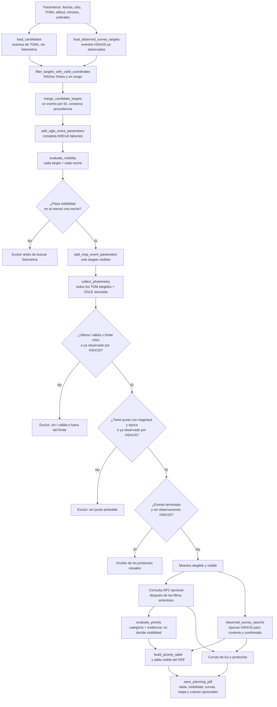

# Flujo del plan estacional

Este documento describe el flujo que ejecuta [`notebooks/workflows/seasonal_observing_plan.ipynb`](../notebooks/workflows/seasonal_observing_plan.ipynb). Las funciones reutilizables viven en `target_selection.planning`, `target_selection.tasks` y `target_selection.prioritization`.

## Parámetros que definen una corrida

La primera celda del notebook configura:

| Parámetro | Uso |
|---|---|
| `START_DATE`, `END_DATE` | Fechas de las noches a evaluar, inclusive. |
| `OBSERVATORY` | Sitio para calcular altitud y ventanas observables. |
| `PROVIDERS` | TOMs consultados; `None` significa todos los TOM registrados. |
| `MIN_ALTITUDE_DEG` | Altitud mínima para acumular minutos observables; valor actual: 40°. |
| `MIN_VISIBLE_MINUTES` | Minutos mínimos por noche; actualmente 30. Basta pasar el umbral en una noche del rango. |
| `LOAD_PHOTOMETRY` | Habilita las consultas de fotometría TOM/OGLE posteriores a visibilidad. |
| `LOAD_LSST_PHOTOMETRY` | Consulta DP2 para los targets que llegaron a la muestra final de análisis. |
| `PRIORITY_CONFIG` | Umbrales del priorizador y límites de magnitud I para HSH/JS. |

`PriorityConfig` expone, entre otros, significancia y número mínimo de puntos para una subida, ventana temporal para datos externos desactualizados, intervalo de visita planificado y ventanas de etapa expresadas en `tE`. Sus valores se pueden cambiar en esa celda; los criterios están descritos en [`docs/contracts/priority.md`](contracts/priority.md).

El notebook usa una caché común. Las consultas TOM/OGLE se refrescan una vez por día UTC; la consulta de Rubin sigue su política de colección/caché. Los parámetros de prioridad no sustituyen los filtros de visibilidad ni de magnitud.

## Diagrama del flujo

Los rombos resumen las puertas reales del notebook; el detalle de cada una está debajo. Los targets sin coordenadas válidas se descartan antes de visibilidad. La selección comienza con **visibilidad**, antes de descargar curvas. Los targets que no pasan esa puerta no llegan a `collect_photometry`.

## Funciones, entradas, salidas y filtros

| Etapa y función | Entradas principales | Qué hace y qué deja pasar | Salida principal |
|---|---|---|---|
| `load_candidates(PROVIDERS, start_date, end_date, include_photometry=False, cache_dir, output_dir)` | TOMs registrados, fechas y filtros opcionales | Carga catálogos de eventos, no curvas. MOP recibe el rango de fechas y puede usar su consulta nativa de visibilidad. BHTOM usa por defecto la clase `Microlensing Event`; los demás TOM conservan sus reglas de origen. | Tabla de eventos TOM con coordenadas y procedencia. |
| `load_observed_survey_targets(database_path=...)` + `update_observed_survey_target_catalog(observed, tom_targets, catalog_path=...)` | Inventarios locales HSH/JS, registro persistente y resultados de las consultas diarias TOM | Recupera los eventos observados y acumula en `outputs/cache/catalogs/observed_survey_targets.csv` sus coordenadas válidas, `observed_by`, `tom_source` y campos del TOM cuando el target está en el catálogo actualizado. Conserva entradas previas si un catálogo diario no devuelve el target. | Catálogo reutilizable y copia de corrida `previously_observed_survey_targets.csv`. |
| `filter_targets_with_valid_coordinates(targets)` | Una tabla de targets | Descarta antes de visibilidad todo target sin RA/Dec finitos o con RA fuera de `[0, 360)` o Dec fuera de `[-90, 90]`. | Solo targets con coordenadas ICRS válidas. |
| `merge_candidate_targets(tom_targets, survey_targets)` | Catálogos ya validados | Une por nombre canónico, combina duplicados y conserva fuentes/procedencia. | Catálogo único de candidatos. |
| `add_ogle_event_parameters(targets, cache_dir=...)` | Catálogo y OGLE EWS | Solo completa `t0`, `tE` y `u0` que falten; no reemplaza valores TOM existentes ni elimina eventos. | Catálogo enriquecido. |
| `evaluate_visibility(targets, output_path, start_date, end_date, observatory, minimum_altitude_deg, minimum_observable_minutes)` | Catálogo con coordenadas, noches y parámetros del sitio | Evalúa, con muestreo de un minuto, el tiempo durante noche astronómica (Sol bajo −18° y dentro de las ventanas asignadas) en que la altitud es al menos `minimum_altitude_deg`. Una noche pasa si acumula al menos `minimum_observable_minutes`; un target pasa el rango si pasa **una o más noches**. | `visibility_by_night`, resumen por target y `visible_targets`. Los que fallan no reciben consultas de fotometría. |
| `add_mop_event_parameters(visible_targets, cache_dir=...)` | Solo candidatos visibles | Completa parámetros/evento de MOP faltantes para los visibles. | Parámetros MOP unidos a los candidatos visibles. |
| `collect_photometry(photometry_targets, providers, query_all_tom_providers=True, include_associated_surveys=True, cache_dir, output_dir)` | Solo candidatos visibles | Busca en todos los TOM configurados, no solo en el TOM que descubrió el evento. Para eventos OGLE puede agregar fotometría OGLE asociada. | Mediciones normalizadas con target, proveedor, magnitud, banda y época. |
| Validación de fotometría en la celda 7 | Filas devueltas y configuración de límites | Separa filas con magnitud medible; identifica proveedores TOM y surveys. Para seleccionar la última I admite `i`, `ogle_i`, `ztf_i`, `lsst_i`, con magnitud positiva y época válida; toma la época I más reciente. | Métrica de última I y listas de eventos excluidos por falta de datos o magnitud. |
| Puerta de magnitud en la celda 7 | Última magnitud I y `PRIORITY_CONFIG.magnitude_limits` | Para el PDF actual, un target nuevo pasa si su última I es `≤` el límite HSH (actualmente 16.5). Un target previamente observado por HSH/JS pasa esta puerta aunque no tenga nueva I. El límite JS (actualmente 18) se calcula para diagnóstico, pero **no** decide `eligible_for_final_pdf` en este notebook. Además, un evento terminado (estado explícito o etapa modelada `post-baseline`) se excluye de los productos visuales si no tiene observaciones previas HSH/JS. | `eligible_for_final_pdf` para visibles que pasan I o tienen observación HSH/JS previa. |
| Puerta de punto ploteable en la celda 7 | Mediciones, épocas y marca de observación previa | Exige magnitud finita y época reconocible (HJD, MJD o timestamp); excepción para targets previamente observados por HSH/JS. | `final_targets` y `pipeline_filter_audit.csv`. |
| Visibilidad en los productos finales, celda 7 | Etapa calculada desde `t0/tE`, estado del evento y observaciones HSH/JS previas | Oculta un evento terminado si nunca tuvo observaciones HSH/JS; conserva para visualización eventos activos/desconocidos y terminados con observaciones previas. No borra el registro del catálogo TOM. | `finished_unobserved_targets_not_visualized.csv` y `eligible_for_final_pdf`. |
| `data_source.lsst.photometry(targets, method='dia_combined_catalog', output_path=...)` (opcional) | Solo `final_targets`, cuando `LOAD_LSST_PHOTOMETRY=True` | Consulta la colección DP2 después de las puertas TOM/I; conserva filas con `measurement_status == 'measured'` y las agrega a la fotometría para prioridad y curvas. No puede recuperar un target ya excluido antes de esta consulta. | Filas Rubin añadidas a `all_observations` y `observations`. |
| `build_priority_evidence(candidate_catalog, all_observations, all_visibility_summary, as_of, config)` | Candidatos, curvas, visibilidad y configuración | Calcula parámetros y métricas por target sin asignar categoría; conserva también filas sin fotometría para inspeccionar la evidencia. `notebooks/analysis/priority_assessment.ipynb` consume esta salida y presenta una celda activable por criterio. | Evidencia intermedia por target. |
| `evaluate_priority(candidate_catalog, all_observations, all_visibility_summary, as_of, config)` | Catálogo coordenada-válido, fotometría disponible, visibilidad y `PriorityConfig` | Evalúa evidencia y asigna categoría/razón. Internamente omite targets sin fotometría utilizable; **no** usa categoría para decidir visibilidad ni para excluir del PDF. Sus umbrales están en `target_selection/prioritization.py`. | Evaluación de prioridad, configuración efectiva y descartes sin fotometría. |
| `observed_survey_epochs(targets, database_path=...)` | IDs del catálogo y base local de épocas | Recupera épocas HSH/JS para fechas observadas. Informa y sombrea observaciones previas; una época no equivale a fotometría calibrada. | Épocas HSH/JS unidas a curvas/tablas cuando corresponde. |
| `build_priority_table(...)`, `save_priority_products(...)`, `visibility_plots(...)`, `save_planning_pdf(...)` | Eventos elegibles, mediciones, épocas, visibilidad y rutas | Forman la tabla visible, mapa, curvas y plots. `save_planning_pdf` concatena las imágenes que ya existen; no aplica filtros científicos nuevos. | PDF estacional. El notebook copia a `FINAL_OUTPUT` el PDF y el PNG/CSV de prioridad visible; deja los demás productos e intermedios en `OUTPUT` (actualmente `/tmp/seasonal_observing_plan_output`). |

## Interpretación de las puertas actuales

Hay dos detalles que conviene tener presentes al leer los resultados:

1. **La regla de fotometría del código no exige explícitamente que el proveedor sea un TOM.** La celda considera mediciones TOM y fotometría de surveys asociados en `usable_photometry`; además, la elegibilidad final se decide por última I válida dentro del límite HSH o por observación previa HSH/JS. Por eso fotometría OGLE asociada puede aportar la última I. Si la regla científica deseada es “al menos una medición de un TOM”, hay que agregar una puerta explícita basada en `tom_measurements` antes de la evaluación de prioridad.
2. **DP2 se consulta después de decidir elegibilidad con la fotometría disponible antes de Rubin.** Por tanto, una detección DP2 no rescata en esta corrida un objeto que ya quedó fuera por no pasar la I HSH o por no tener punto ploteable.

También hay una diferencia entre la tabla y los plots: la tabla visible se construye desde `eligible_for_final_pdf`, que admite observados HSH/JS sin fotometría reciente. Las curvas/plots parten de `priority` intersectado con `final_targets`; `evaluate_priority` quita targets sin fotometría utilizable. Un evento observado previamente pero sin ninguna fotometría utilizable puede aparecer en la tabla, pero quedar fuera de esas curvas/plots.

El catálogo acumulativo contiene `tom_source` para conservar la procedencia TOM de cada evento observado. Las consultas de catálogo TOM se refrescan mediante la caché diaria antes de actualizar las filas encontradas; los campos de una fila no se pueden refrescar desde un proveedor cuando ese proveedor no devuelve el target. `tom_data_updated_utc` registra cuándo el target coincidió con los datos TOM usados por la corrida.

## Diferencia con el CLI

Este diagrama corresponde al notebook estacional, que incorpora HSH/JS, parámetros MOP para los visibles y límites I específicos del PDF HSH. `target_selection/planning_cli.py` sigue un flujo más simple: no carga el inventario local HSH/JS, la fotometría se habilita con `--with-photometry`, puede limitar su consulta previa con `--photometry-scope visible`, y `--magnitude-max` aplica un límite genérico opcional. No debe suponerse que ambos caminos aplican las mismas puertas.

El diagrama de [`docs/planning_pipeline/priority_flow/decision_flow.md`](planning_pipeline/priority_flow/decision_flow.md) cubre únicamente los criterios científicos del priorizador; no sustituye este flujo de extremo a extremo.
