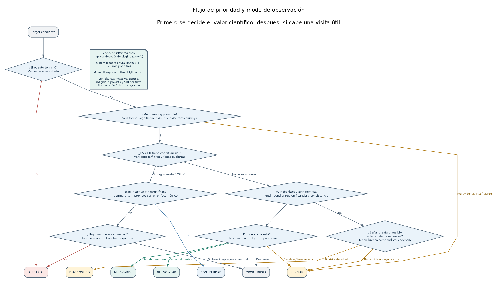

# Target priority and observing-mode flow

## Purpose

This is the first-pass decision process used by `evaluate_priority` for HSH/JS microlensing follow-up. It assigns an evidence-based category and a reproducible rank within that category; it does not combine unlike criteria in a weighted score. Scientific category and observing feasibility remain separate: a target can be scientifically interesting but still lack a usable window or S/N.

## Scientific decision path

1. **Establish the event state from data.** Check current survey photometry and event status to determine whether the event has ended or is changing too slowly for the planned cadence. A baseline visit remains possible when it answers a specific question.
2. **Check microlensing evidence.** Look at the shape and significance of the measured rise, agreement between available surveys, and competing classifications. A broker score by itself is not enough.
3. **Separate new targets from CASLEO follow-up.** For a new event, require a clear rise before assigning `NUEVO-RISE` or `NUEVO-PEAK`. If the evidence is plausible but the curve is stale, one `DIAGNÓSTICO` visit may establish its current state. For an event already observed by CASLEO, prefer a visit that adds a phase or a measurable change. The raw number of prior acquisitions is not a reason by itself to observe again.
4. **Use the observing gap carefully.** Missing recent survey data can justify one diagnostic measurement when there is credible prior evidence that the event was active. It does not make a flat or already rejected variable a microlensing target.

## What to measure at each decision

The numbers below are the quantities to inspect or calculate. Their cutoffs are intentionally left open until they can be calibrated with survey cadence and HSH/JS performance.

| Decision block | Metric or verification | How to use it |
| --- | --- | --- |
| Event state | Latest same-band measurements and dates; OGLE event page/status where applicable; survey classification; predicted `Δm` over the planned visit interval compared with the expected photometric error. | Mark explicitly completed events as finished. Treat a change as too slow to measure when predicted `Δm` is below the empirical repeat-measurement uncertainty. Set the threshold from HSH/JS data. |
| Microlensing plausible? | Light-curve morphology; significance of the rise relative to point scatter; consistency across available surveys; competing variable classifications. | Use the curve and its uncertainty, not a broker label alone. Define required significance, point count, and cross-survey agreement after reviewing examples. |
| CASLEO coverage useful? | Number and dates of usable epochs/images, filters, available photometric uncertainties, and which event phases they cover (baseline, rise, peak, decline). | Judge whether another visit adds a phase or fills a meaningful gap. Image counts are labeled as coverage; they are not treated as photometric measurements or used as error estimates. |
| Clear rise? | Fitted slope and its uncertainty over a stated time interval; number of consecutive measurements consistent with brightening; corroboration by another survey. | Establish the interval, significance, and minimum points from real light curves. This gate is for new events before assigning `NUEVO-RISE` or `NUEVO-PEAK`. |
| Prior signal but stale data? | Time since the last useful external measurement versus that survey's normal cadence; last measured magnitude and trend; predicted current-state uncertainty. | A large gap supports one diagnostic visit only when the earlier signal was credible. Calibrate what counts as a stale gap for each data source. |
| Current stage | Recent slope/curvature, distance in time to predicted peak, and uncertainty on peak time from an event fit when available. | Distinguish an early rise from near-maximum and other useful phases. Keep a stage uncertain when data do not support a reliable peak estimate. |
| Active CASLEO follow-up? | Predicted `Δm` between now and the proposed visit interval versus the uncertainty of a difference between two HSH/JS measurements; phases already sampled. | Continue when the event is active and the next epoch adds a phase or a measurable change. Estimate the uncertainty empirically by filter and magnitude. |
| Specific gap or baseline question? | Identify the missing phase or baseline constraint and estimate the expected S/N and value of one measurement. | Use `OPORTUNISTA` only when the measurement answers a stated question; otherwise discard or leave unscheduled. |
| Observing mode and visibility | Time above the adopted altitude limit, maximum airmass during the block, predicted magnitude and S/N per filter, and exposure/readout overhead. | Fit a two-filter block when at least 40 useful minutes remain (20 per filter). For a shorter window, allow one-filter diagnosis only if the expected S/N and exposure count support an interpretable measurement. |

For repeat observations, calculate `Δm = |m(t + Δt) − m(t)|` from recent same-band photometry or an event-model posterior. Compare it with the measured uncertainty of a difference between two HSH/JS epochs. This makes the slow-event decision depend on whether HSH/JS can detect change at the actual visit spacing, rather than on `tE` alone.

## Categories

| Category | Meaning |
| --- | --- |
| `NUEVO-RISE` | New target with a convincing rise and useful early-phase coverage still available. |
| `NUEVO-PEAK` | New target with a convincing event near maximum, where a timely measurement can add useful coverage. |
| `CONTINUIDAD` | Previously observed by CASLEO; the event remains active and another visit adds a phase or measurable change. |
| `DIAGNÓSTICO` | One measurement to establish the present state because the event is plausible but recent external data are missing. |
| `OPORTUNISTA` | A plausible event in decline, or a specific lower-priority measurement such as a baseline check that answers a stated question. |
| `REVISAR` | Evidence is incomplete or conflicts, so the evaluator leaves the scientific classification open for team review. It is not included in the schedule candidate list automatically. |
| `DESCARTAR` | Explicitly finished, in post-event baseline, or a repeat that adds no phase or measurable change. Brightness and nightly visibility are handled separately as feasibility. |

The evaluator orders categories as `NUEVO-RISE`, `NUEVO-PEAK`, `CONTINUIDAD`, `DIAGNÓSTICO`, `OPORTUNISTA`, `REVISAR`, `DESCARTAR`. Within a category it sorts by a stated metric: rise significance, distance from modeled peak, predicted change relative to the HSH/JS measurement uncertainty, age of external data, or latest magnitude. Ties use `target_id` for deterministic output.

## Observing mode

The diagram's observing-mode decision follows the scientific classification:

- **Two filters:** use when a complete 40-minute block fits in the usable visibility window: 20 minutes in each filter. Start in the filter already loaded and switch once at the midpoint.
- **Single-filter diagnostic:** use when 40 minutes do not fit but enough time remains for a reliable magnitude estimate in one filter. Define this minimum from the required number of exposures, exposure and readout times, pointing overhead, and the S/N needed to answer the diagnostic question.
- **No useful slot:** do not schedule when there is insufficient time or expected S/N for an interpretable measurement.

The altitude cutoff is a configurable scheduling rule. For a 40-minute block, verify that the full block remains above the adopted altitude threshold, currently 40 degrees. A shorter diagnostic visit should be assessed against the same altitude rule unless the observing team explicitly adopts a different one.

## Values that still need calibration

The evaluator exposes its first-pass cutoffs in `PriorityConfig`, writes them to `priority_config.json`, and leaves the scientific uncertainties visible. Current defaults are provisional and should be tuned against reviewed light curves and instrument data:

- Rise significance at least 3σ from at least 3 same-survey/same-band points in the previous 90 days.
- Stale external photometry when none is available, or when at least 3 distinct external epochs exist and the latest gap exceeds 2 times that survey's median cadence.
- A 7-day planned visit interval for the model-predicted change metric.
- Event stage from `τ = (date − t0) / tE`: rise for `−2 ≤ τ < −0.3`, peak for `|τ| ≤ 0.3`, decline for `0.3 < τ ≤ 2`, with earlier/later dates as baseline.
- Current magnitude compared with provisional planning limits HSH 16.5 and JS 18. These flags use the latest available magnitude as a proxy and still need filter-specific S/N and saturation checks.
- Minimum diagnostic duration and exposure count for a reliable one-filter magnitude.
- Minimum detectable change, derived from differential-photometry scatter versus magnitude, filter, crowding, and airmass.
- A practical maximum airmass and any additional sky or Moon constraints.
- What constitutes a clear rise: significance, number of points, time span, and whether independent surveys agree.
- The interval between planned visits used to test if predicted variation is measurable.

For repeat observations, estimate the expected change over the actual interval between visits, `Δm = |m(t + Δt) − m(t)|`, from recent same-band photometry or an event-model posterior. Compare it with the empirically measured uncertainty of the difference between two HSH/JS epochs. Do not reject a long `tE` automatically; reject or lower its priority when the expected change over the planned interval is below the instrument's measurable threshold. A stale but credible event can still receive one diagnostic visit.

## Implementation note

Store the event state and evidence, last external observation, CASLEO/JS phase coverage, expected magnitude by filter, expected change over the next visit interval, visibility window, category, category rank, assessment status, and decision reason as separate fields. The evaluator writes `priority_assessment.csv` and the exact `PriorityConfig` to `priority_config.json` so every result can be reproduced and reviewed.
