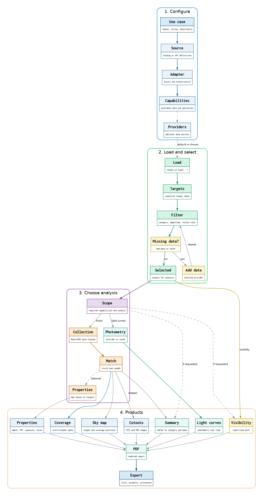
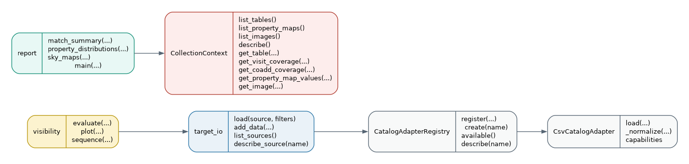
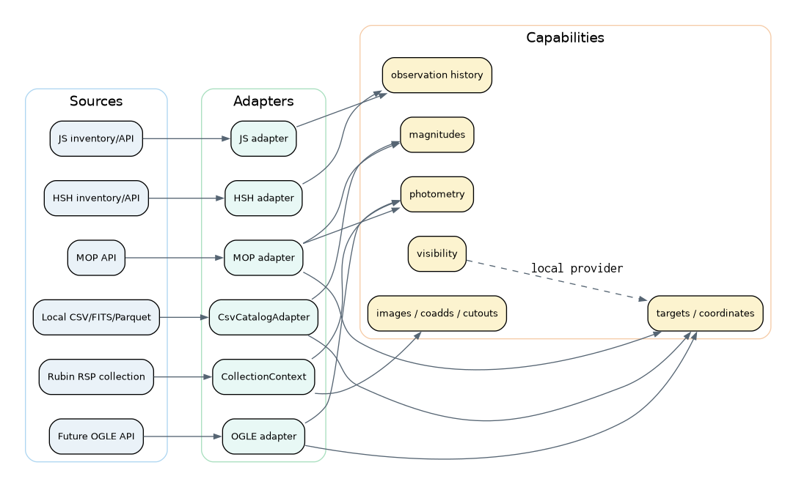

# Version 2 architecture

This page documents the modular API under development on the
`feature/target-selection-pipeline` branch. The notebooks in `notebooks/v2/`
use this API. The older notebooks in `notebooks/` are historical analyses and
are not compatibility targets for this version.

## Main layers

The tool is organized around five layers:

1. **Source definitions** describe files or external services and their
   capabilities.
2. **Adapters** access one source and return canonical target data.
3. **Selection and matching** apply scientific/observing filters and query
   Rubin collections.
4. **Products** write tables, plots, cutouts and reports.
5. **Notebooks** combine small operations for a specific scientific use case.

[Download the integrated workflow as PDF](assets/v2_diagrams/v2_target_selection_workflow.pdf)

## Public objects and functions

[Download the public API diagram as PDF](assets/v2_diagrams/v2_public_api.pdf)

## Sources, adapters and capabilities

A source configuration identifies an adapter. The adapter is responsible for
source-specific access and normalization. Capabilities describe what the
source can provide; they are not the same as the role the source plays in one
analysis.

[Download the sources/adapters diagram as PDF](assets/v2_diagrams/v2_sources_capabilities.pdf)

A new provider should implement only its adapter and declare its capabilities.
It should not add OGLE-specific conditions to `target_io`, `CollectionContext`, or the
report functions. See [Catalog sources and adapters](source-adapters.md).

## Current versus legacy code

The current public surface is the small modular API described above. Existing
role-based adapters in `sources/adapters.py` and the large coordinator in
`workflow.py` belong to the earlier configuration workflow. They remain in the
repository while the new API is developed, but the `v2` notebooks do not depend
on them as their main entry point.
