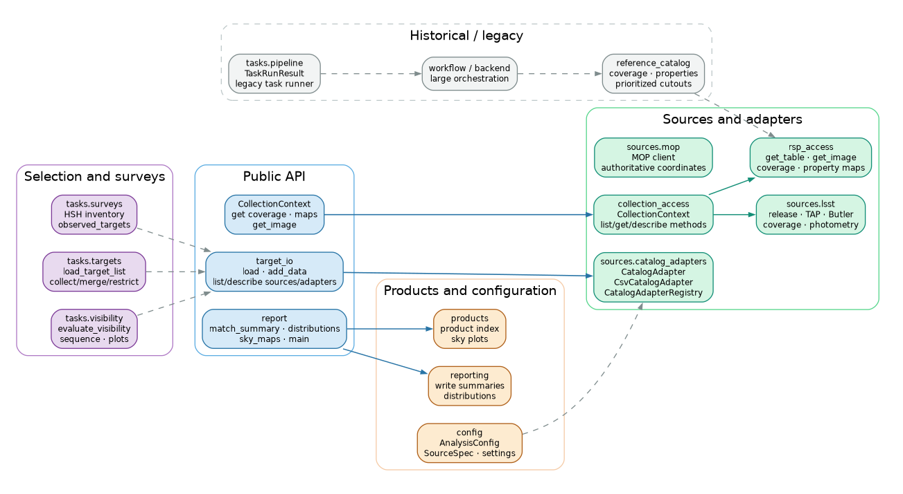

# Version 2 tools at a glance



[Download the tools inventory as PDF](assets/v2_diagrams/v2_tools_inventory.pdf)

This is a compact inventory of the recommended public tools. Private helpers and legacy implementation details are intentionally omitted.

## Public API

| Module | Main tools | Purpose |
|---|---|---|
| `target_io` | `load`, `add_data`, `list_sources`, `describe_source`, `list_adapters`, `describe_adapter`, `register_adapter` | Load and enrich canonical target tables |
| `visibility` | `evaluate`, `plots`, `sequence` | Evaluate and visualize observability |
| `CollectionContext` | `get_visit_coverage`, `get_coadd_coverage`, `get_property_map_values`, `get_image` | Match targets and retrieve collection products |
| `report` | `match_summary`, `property_distributions`, `sky_maps`, `main` | Write analysis tables, plots and PDF reports |
| `prioritization` | `apply_magnitude_limits`, `summarize_photometry`, `build_priority_table` | Reusable microlensing selection and ranking logic |

## Source and collection access

| Module/class | Main tools | Purpose |
|---|---|---|
| `sources.catalog_adapters` | `CatalogAdapter`, `CsvCatalogAdapter`, `CatalogAdapterRegistry`, `default_catalog_registry` | Read and normalize configured catalogs |
| `collection_access.CollectionContext` | `list_tables`, `list_property_maps`, `list_images`, `describe`, `get_table`, `get_visit_coverage`, `get_coadd_coverage`, `get_property_map_values`, `get_image` | Discover and access one Rubin collection |
| `collection_access` | `open_collection`, `load_collection_coverage`, `load_collection_coadds`, `generate_collection_cutouts`, `build_collection_report_pdf` | Convenience access and historical product helpers |
| `rsp_access` | `get_table`, `get_image`, `get_visit_coverage`, `get_coadd_coverage`, `get_property_map_values`, `list_tables`, `list_images`, `list_property_maps`, `describe` | Lower-level RSP/Butler operations |

## Selection, surveys and photometry

| Module | Main tools | Purpose |
|---|---|---|
| `tasks.visibility` | `evaluate_visibility`, `make_visibility_sequence`, `save_visibility_plots` | Observability by date, time, altitude and duration |
| `tasks.targets` | `load_target_list`, `collect_mop_targets`, `merge_targets`, `restrict_targets` | Target-list and MOP operations |
| `sources.lsst` | `resolve_data_release`, `create_tap_service`, `create_butler`, `query_visit_coverage`, `query_visit_centers`, `compute_release_photometry`, `save_release_photometry`, `load_release_photometry`, `save_target_release_photometry`, `find_coadds_for_target` | Rubin release and photometry access |
| `sources.mop` | `create_client`, `apply_authoritative_coordinates` | MOP-specific access and coordinate handling |
| `tasks.surveys` | `import_hsh_inventory`, `observed_targets` | Follow-up survey inventories |

## Configuration and support

| Module | Main tools | Purpose |
|---|---|---|
| `config` | `SourceSpec`, `SelectionSettings`, `ProductSettings`, `CacheSettings`, `RuntimeSettings`, `AnalysisConfig`, `load_config` | Configuration models |
| `run_paths` | `create_run_structure` | Standard output and cache directories |
| `reporting` | `numeric_series`, `write_collection_summaries`, `plot_collection_distributions` | Shared summary and plot helpers |
| `products` | `write_product_index`, `plot_sky_dual_metric` | Shared product utilities |

## Historical modules

`match.py` and `images.py` are thin compatibility wrappers and are not needed by new notebooks. `backend.py`, `workflow.py`, `reference_catalog.py` and `tasks/pipeline.py` contain older end-to-end orchestration. They are useful for auditing existing analyses, but new notebooks should start from the public API above.

## Quick discovery

```python
from target_selection import target_io

target_io.list_sources()
target_io.describe_source()
target_io.list_adapters()
target_io.describe_adapter()
```

For a Rubin collection:

```python
from target_selection import open_collection

collection = open_collection("DP2")
collection.describe()
collection.list_tables()
collection.list_images()
collection.list_property_maps()
```
